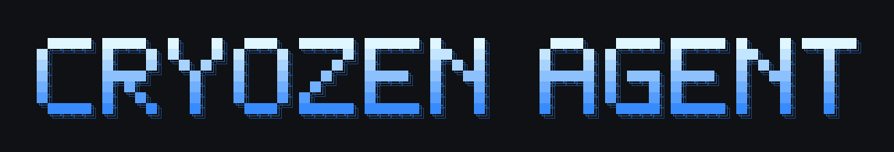

<p align="center">
  
</p>

# Cryozen Agent

> **Preview, not released.** Cryozen Agent is under active development.
> There is no installer, package, release, or documentation site yet, and commands may change.
> To try it, [run it from source](#run-from-source). The docs live in [`website/docs`](website/docs/index.mdx).

<p align="center">
  <a href="https://github.com/cryozenai/cryozen-agent/blob/main/LICENSE"></a>
  <a href="README.es.md"></a>
  <a href="README.ur-pk.md"></a>
</p>

**Cryozen Agent is a self-improving AI agent from [Cryozen](https://github.com/cryozenai).**
It learns as it works: it writes reusable skills from experience, refines them while using them, keeps a persistent memory, searches its own past conversations, and builds a model of how you like to work across sessions.
Run it on your laptop, a small VPS, a GPU server, or serverless infrastructure that costs almost nothing while idle, and talk to it from your terminal, the desktop app, or a messaging app such as Telegram.

Bring the model you prefer: Anthropic, OpenAI, OpenRouter, a local model server, or [many other providers](website/docs/integrations/providers.md).
Switch at any time with `cryozen model`, with no code changes and no lock-in.

<table>
<tr><td><b>A real terminal interface</b></td><td>Full TUI with multiline editing, slash-command autocomplete, conversation history, interrupt-and-redirect, and streaming tool output.</td></tr>
<tr><td><b>Lives where you do</b></td><td>Telegram, Discord, Slack, WhatsApp, Signal, email and more from a single gateway process, with voice-memo transcription and conversation continuity across platforms.</td></tr>
<tr><td><b>A closed learning loop</b></td><td>Agent-curated memory, automatic skill creation after complex tasks, skills that improve with use, and full-text session search with summarization for cross-session recall. Skills follow the open <a href="https://agentskills.io">agentskills.io</a> format.</td></tr>
<tr><td><b>Scheduled automations</b></td><td>A built-in cron scheduler that delivers to any platform: daily reports, nightly backups, weekly audits, described in plain language and run unattended.</td></tr>
<tr><td><b>Delegates and parallelizes</b></td><td>Isolated subagents for parallel workstreams, and Python scripts that call tools over RPC to collapse multi-step pipelines into a single turn.</td></tr>
<tr><td><b>Runs anywhere</b></td><td>Terminal backends for local, Docker, SSH, Singularity, Modal, Daytona and Vercel Sandbox. Serverless backends hibernate when idle and wake on demand.</td></tr>
<tr><td><b>Research-ready</b></td><td>Batch trajectory generation and trajectory compression for evaluating and training tool-calling models.</td></tr>
</table>

---

## Run from source

Cryozen Agent is in preview, so no installer is published.
To try it, run it from a clone, keeping the virtual environment outside the source tree because the agent can run commands against its own checkout:

```bash
git clone https://github.com/cryozenai/cryozen-agent.git
cd cryozen-agent
curl -LsSf https://astral.sh/uv/install.sh | sh    # skip if you already have uv
uv venv ~/.cryozen-agent/venvs/cryozen-dev --python 3.11
source ~/.cryozen-agent/venvs/cryozen-dev/bin/activate
uv pip install -e ".[all,dev]"
cryozen            # start chatting
```

On native Windows, run `powershell -ExecutionPolicy ByPass -File scripts\install.ps1` from the clone instead.

### Troubleshooting

#### Antivirus flags `uv.exe` on Windows

Some antivirus engines quarantine `uv.exe` from `%LOCALAPPDATA%\cryozen\bin\`.
This is a false positive: the file is Astral's `uv`, the Python package manager Cryozen uses to manage its environment.
You can verify your copy against Astral's signed release:

```powershell
winget install --id GitHub.cli
gh auth login
$uv = "$env:LOCALAPPDATA\cryozen\bin\uv.exe"
$ver = (& $uv --version).Split(' ')[1]
[Net.ServicePointManager]::SecurityProtocol = [Net.SecurityProtocolType]::Tls12
$zip = "$env:TEMP\uv.zip"
Invoke-WebRequest "https://github.com/astral-sh/uv/releases/download/$ver/uv-x86_64-pc-windows-msvc.zip" -OutFile $zip -UseBasicParsing
gh attestation verify $zip --repo astral-sh/uv
Expand-Archive $zip "$env:TEMP\uv_x" -Force
(Get-FileHash "$env:TEMP\uv_x\uv.exe").Hash -eq (Get-FileHash $uv).Hash
```

If attestation reports "Verification succeeded" and the last line prints `True`, the binary is authentic.
To allow it, exclude the folder (not the file hash, which changes with every `uv` update), for example with `Add-MpPreference -ExclusionPath "$env:LOCALAPPDATA\cryozen\bin"` in an administrator PowerShell.

---

## Getting started

```bash
cryozen              # interactive CLI: start a conversation
cryozen model        # choose your provider and model
cryozen tools        # choose which tools are enabled
cryozen config set   # set a config value
cryozen config get   # print a config value
cryozen gateway      # run the messaging gateway (Telegram, Discord, ...)
cryozen setup        # full setup wizard
cryozen claw migrate # import settings from OpenClaw
cryozen update       # update to the latest version
cryozen doctor       # diagnose problems
```

Full documentation: **[website/docs](website/docs/index.mdx)**

---

## CLI and messaging quick reference

Start the terminal UI with `cryozen`, or run the gateway and talk to Cryozen from Telegram, Discord, Slack, WhatsApp, Signal or email.
Most slash commands work in both.

| Action                         | CLI                                           | Messaging platforms                                                               |
| ------------------------------ | --------------------------------------------- | --------------------------------------------------------------------------------- |
| Start chatting                 | `cryozen`                                     | Run `cryozen gateway setup` and `cryozen gateway start`, then message the bot      |
| Start a fresh conversation     | `/new` or `/reset`                            | `/new` or `/reset`                                                                |
| Change model                   | `/model [provider:model]`                     | `/model [provider:model]`                                                         |
| Set a personality              | `/personality [name]`                         | `/personality [name]`                                                             |
| Retry or undo the last turn    | `/retry`, `/undo`                             | `/retry`, `/undo`                                                                 |
| Compress context / check usage | `/compress`, `/usage`, `/insights [--days N]` | `/compress`, `/usage`, `/insights [days]`                                         |
| Browse skills                  | `/skills` or `/<skill-name>`                  | `/<skill-name>`                                                                   |
| Interrupt current work         | `Ctrl+C` or send a new message                | `/stop` or send a new message                                                     |
| Platform status                | `/platforms`                                  | `/status`, `/sethome`                                                             |

See the [CLI guide](website/docs/user-guide/cli.md) and the [messaging gateway guide](website/docs/user-guide/messaging/index.md) for every command.

---

## Documentation

| Section                                                                                                  | What it covers                                             |
| -------------------------------------------------------------------------------------------------------- | ---------------------------------------------------------- |
| [Quickstart](website/docs/getting-started/quickstart.md)                   | Install, set up, and hold a first conversation             |
| [CLI usage](website/docs/user-guide/cli.md)                                | Commands, keybindings, personalities, sessions             |
| [Configuration](website/docs/user-guide/configuration.md)                  | Config file, providers, models, all options                |
| [Messaging gateway](website/docs/user-guide/messaging/index.md)                  | Telegram, Discord, Slack, WhatsApp, Signal, Home Assistant |
| [Security](website/docs/user-guide/security.md)                            | Command approval, DM pairing, container isolation          |
| [Tools and toolsets](website/docs/user-guide/features/tools.md)            | Built-in tools, toolsets, terminal backends                |
| [Skills](website/docs/user-guide/features/skills.md)                       | Procedural memory, the skills hub, writing skills          |
| [Memory](website/docs/user-guide/features/memory.md)                       | Persistent memory, user profiles, best practices           |
| [MCP](website/docs/user-guide/features/mcp.md)                             | Connect any MCP server                                     |
| [Cron scheduling](website/docs/user-guide/features/cron.md)                | Scheduled tasks with platform delivery                     |
| [Context files](website/docs/user-guide/features/context-files.md)         | Project context that shapes every conversation             |
| [Architecture](website/docs/developer-guide/architecture.md)               | Project structure, agent loop, key classes                 |
| [Contributing](website/docs/developer-guide/contributing.md)               | Development setup, pull requests, code style               |
| [CLI reference](website/docs/reference/cli-commands.md)                    | Every command and flag                                     |
| [Environment variables](website/docs/reference/environment-variables.md)   | Complete environment variable reference                    |

---

## Migrating from OpenClaw

Cryozen can import your OpenClaw settings, memories, skills and API keys.
The setup wizard (`cryozen setup`) detects `~/.openclaw` and offers to migrate before configuration begins, or you can run it at any time:

```bash
cryozen claw migrate                    # interactive migration (full preset)
cryozen claw migrate --dry-run          # preview what would be migrated
cryozen claw migrate --preset user-data # migrate without secrets
cryozen claw migrate --overwrite        # overwrite existing conflicts
```

It imports your persona (`SOUL.md`), memories (`MEMORY.md`, `USER.md`), user-created skills (into `~/.cryozen-agent/skills/openclaw-imports/`), command allowlist, messaging settings, allowlisted API keys, TTS assets, and workspace instructions (`AGENTS.md`, with `--workspace-target`).
Run `cryozen claw migrate --help` for all options.

---

## Development

See the [contributing guide](website/docs/developer-guide/contributing.md) for development setup, code style and the pull request process.

Set up as in [Run from source](#run-from-source), then run the tests:

```bash
CRYOZEN_PYTHON="$VIRTUAL_ENV/bin/python" scripts/run_tests.sh
```

---

## Support

- Bugs and questions: [GitHub Issues](https://github.com/cryozenai/cryozen-agent/issues)
- Security reports: see [SECURITY.md](SECURITY.md)

---

## License

Cryozen Agent is released under the MIT License; see [LICENSE](LICENSE) and [NOTICE](NOTICE).
It incorporates [Hermes Agent](https://github.com/NousResearch/hermes-agent) by Nous Research, also under the MIT License.

Copyright (c) 2026 Cryozen.
