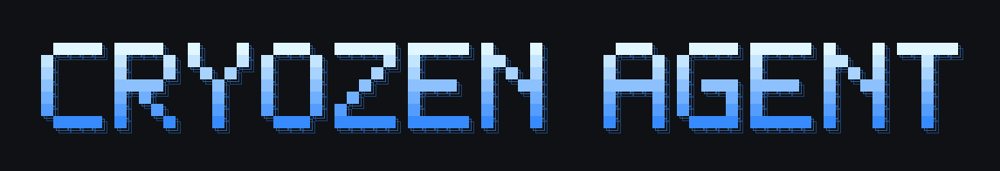

<div dir="rtl">

<p align="center">
  
</p>

# کرائیوزن ایجنٹ (Cryozen Agent)

> **پیش نظارہ، ابھی جاری نہیں ہوا۔** کرائیوزن ایجنٹ زیرِ تعمیر ہے۔
> ابھی کوئی انسٹالر، پیکیج، ریلیز یا دستاویزات کی سائٹ موجود نہیں، اور کمانڈز بدل سکتی ہیں۔
> آزمانے کے لیے [سورس سے چلائیں](#سورس-سے-چلائیں)۔ دستاویزات [`website/docs`](website/docs/index.mdx) میں ہیں۔

<p align="center">
  <a href="https://github.com/cryozenai/cryozen-agent/blob/main/LICENSE"></a>
  <a href="README.md"></a>
  <a href="README.es.md"></a>
</p>

**کرائیوزن ایجنٹ، [Cryozen](https://github.com/cryozenai) کا تیار کردہ خود کو بہتر بنانے والا اے آئی (AI) ایجنٹ ہے۔**
یہ کام کرتے ہوئے سیکھتا ہے: تجربے سے دوبارہ استعمال ہونے والی مہارتیں (skills) لکھتا ہے، استعمال کے دوران انہیں بہتر بناتا ہے، مستقل میموری رکھتا ہے، اپنی پچھلی گفتگو میں تلاش کرتا ہے، اور سیشنز کے دوران یہ سمجھتا ہے کہ آپ کس طرح کام کرنا پسند کرتے ہیں۔
اسے اپنے لیپ ٹاپ، ایک چھوٹے VPS، GPU سرور یا ایسے سرور لیس (serverless) انفراسٹرکچر پر چلائیں جس کا خرچ غیر فعال ہونے پر تقریباً صفر ہوتا ہے، اور اس سے ٹرمینل، ڈیسک ٹاپ ایپ یا ٹیلی گرام جیسی میسجنگ ایپ سے بات کریں۔

اپنی پسند کا ماڈل استعمال کریں: Anthropic، OpenAI، OpenRouter، لوکل ماڈل سرور، یا [بہت سے دوسرے فراہم کنندگان](website/docs/integrations/providers.md)۔
`cryozen model` کے ذریعے کسی بھی وقت تبدیل کریں، کوڈ میں کسی تبدیلی کے بغیر۔

<table>
<tr><td><b>حقیقی ٹرمینل انٹرفیس</b></td><td>مکمل TUI جس میں ملٹی لائن ایڈیٹنگ، کمانڈ آٹو کمپلیٹ، گفتگو کی ہسٹری، انٹرپٹ اور ری ڈائریکٹ، اور سٹریمنگ ٹول آؤٹ پٹ شامل ہیں۔</td></tr>
<tr><td><b>وہاں موجود جہاں آپ ہیں</b></td><td>ٹیلی گرام، ڈسکارڈ، سلیک، واٹس ایپ، سگنل، ای میل اور مزید، سب ایک ہی گیٹ وے پروسیس سے، وائس نوٹ ٹرانسکرپشن اور پلیٹ فارمز کے درمیان گفتگو کے تسلسل کے ساتھ۔</td></tr>
<tr><td><b>سیکھنے کا مکمل عمل</b></td><td>ایجنٹ کی ترتیب دی گئی میموری، پیچیدہ کاموں کے بعد خودکار مہارت کی تخلیق، استعمال سے بہتر ہونے والی مہارتیں، اور خلاصوں کے ساتھ سیشنز میں مکمل متن کی تلاش۔ مہارتیں کھلے <a href="https://agentskills.io">agentskills.io</a> فارمیٹ پر مبنی ہیں۔</td></tr>
<tr><td><b>شیڈول شدہ خودکار کام</b></td><td>بلٹ ان cron شیڈیولر جو کسی بھی پلیٹ فارم پر نتائج بھیجتا ہے: روزانہ رپورٹس، رات کے بیک اپ، ہفتہ وار آڈٹ، سادہ زبان میں بیان کیے گئے اور خودکار طور پر چلنے والے۔</td></tr>
<tr><td><b>کام کی تقسیم اور متوازی عمل</b></td><td>متوازی کاموں کے لیے الگ ذیلی ایجنٹس، اور Python سکرپٹس جو RPC کے ذریعے ٹولز استعمال کرتی ہیں تاکہ کئی مراحل کا کام ایک ہی قدم میں ہو جائے۔</td></tr>
<tr><td><b>کہیں بھی چلائیں</b></td><td>لوکل، Docker، SSH، Singularity، Modal، Daytona اور Vercel Sandbox کے لیے ٹرمینل بیک اینڈز۔ سرور لیس بیک اینڈز غیر فعال ہونے پر رک جاتے ہیں اور ضرورت پر دوبارہ چل پڑتے ہیں۔</td></tr>
<tr><td><b>تحقیق کے لیے تیار</b></td><td>ٹول استعمال کرنے والے ماڈلز کی جانچ اور تربیت کے لیے بیچ ٹریجیکٹری جنریشن اور ٹریجیکٹری کمپریشن۔</td></tr>
</table>

---

## سورس سے چلائیں

کرائیوزن ایجنٹ ابھی پیش نظارہ (preview) میں ہے، اس لیے کوئی انسٹالر شائع نہیں کیا گیا۔
اسے آزمانے کے لیے ایک کلون سے چلائیں:

<div dir="ltr">

```bash
git clone https://github.com/cryozenai/cryozen-agent.git
cd cryozen-agent
curl -LsSf https://astral.sh/uv/install.sh | sh
uv venv ~/.cryozen-agent/venvs/cryozen-dev --python 3.11
source ~/.cryozen-agent/venvs/cryozen-dev/bin/activate
uv pip install -e ".[all,dev]"
cryozen
```

</div>

نیٹو Windows پر کلون سے `.\scripts\install.ps1` چلائیں۔

---

## آغاز

<div dir="ltr">

```bash
cryozen              # interactive CLI
cryozen model        # choose provider and model
cryozen tools        # choose enabled tools
cryozen gateway      # run the messaging gateway
cryozen setup        # full setup wizard
cryozen update       # update to the latest version
cryozen doctor       # diagnose problems
```

</div>

مکمل دستاویزات: **[website/docs](website/docs/index.mdx)**

---

## معاونت

- خرابیوں اور سوالات کے لیے: [GitHub Issues](https://github.com/cryozenai/cryozen-agent/issues)
- سیکیورٹی رپورٹس: [SECURITY.md](SECURITY.md) دیکھیں

---

## لائسنس

کرائیوزن ایجنٹ MIT لائسنس کے تحت جاری کیا گیا ہے؛ [LICENSE](LICENSE) اور [NOTICE](NOTICE) دیکھیں۔

Copyright (c) 2026 Cryozen.

</div>
